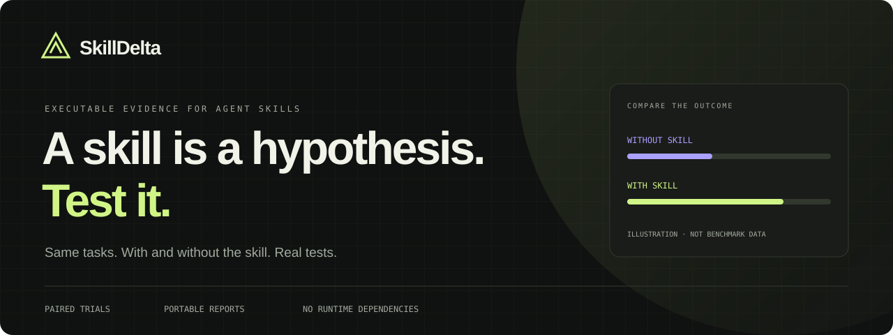

<p align="center">
  
</p>

# SkillDelta

**Measure what a skill changes. Generate code with and without it, run the same held-out tests, and share the results.**

SkillDelta is a small, dependency-free CLI for paired evaluations of coding instructions. It produces an inspectable JSON result, a standalone HTML report, and an SVG badge.

- **Executable checks:** a task passes only when its complete test suite passes.
- **Paired comparisons:** every task runs both with and without the skill.
- **Isolated verification:** live generated code is tested in a resource-limited Docker container without network access or API credentials.
- **Portable reports:** one HTML file, no server, account, analytics, or external assets.

Version 0.1 evaluates **single-turn code generation** through a compatible chat-completions endpoint. It does not run a complete coding agent, install a skill into an agent, or measure multi-turn tool use.

## Try it in a minute

Install [Node.js 22 or newer](https://nodejs.org/), then:

```sh
git clone https://github.com/4onv/skilldelta.git
cd skilldelta
node bin/skilldelta.mjs demo
```

Open `.skilldelta/demo/report.html` in your browser. There is no dependency-install step, API key, or Docker requirement for the demo.

**The demo uses simulated model outputs and real tests.** Its bundled examples deliberately produce **1/3 passing tasks without the skill and 3/3 with it**. Those numbers demonstrate the reporting workflow; they are not evidence that this skill improves any model.

You can also download and open the [sample report](examples/sample-report.html).

## Evaluate your own skill

You need a running Docker installation with Linux containers and a provider exposing a compatible `/v1/chat/completions` endpoint. Live runs may incur provider charges.

Set `SKILLDELTA_API_KEY` in your shell. Keep the key out of source files and command-line arguments. Then inspect the planned run:

```sh
node bin/skilldelta.mjs run --suite examples/suite.json --skill examples/edge-cases/SKILL.md --model YOUR_MODEL --endpoint https://YOUR_PROVIDER/v1/chat/completions --trials 3 --dry-run
```

Remove `--dry-run` to execute it:

```sh
node bin/skilldelta.mjs run --suite examples/suite.json --skill examples/edge-cases/SKILL.md --model YOUR_MODEL --endpoint https://YOUR_PROVIDER/v1/chat/completions --trials 3 --out .skilldelta/run
```

Three tasks × three trials × two conditions means **18 model calls**. Both conditions use the same task prompt, starter files, and test suite. Only the skill condition receives the skill text. Test source is withheld from the model request.

See [the evaluation guide](docs/evaluation.md) for suite authoring, methodology, and limitations, or [the CLI reference](docs/cli.md) for options.

## Read the result

| Output | Purpose |
| --- | --- |
| `results.json` | Machine-readable results, task outcomes, timing, and reported token usage |
| `report.html` | A standalone comparison with task filters and paired wins/losses/ties |
| `badge.svg` | A small result badge suitable for a README |

A positive delta means more complete task trials passed with the skill. It does **not** establish statistical significance or guarantee better performance on other tasks. Provider or runtime errors make the aggregate verdict **inconclusive**. Start with representative tasks, repeat the experiment, and inspect failures.

Rebuild a report from saved results:

```sh
node bin/skilldelta.mjs report .skilldelta/demo/results.json --out .skilldelta/rebuilt
```

Add `--fail-on-regression` to a live run when you want a negative pass-rate delta to fail your automation. Treat that as your chosen gate, not a statistical test.

## Development

```sh
node --test
node bin/skilldelta.mjs demo
```

The CI workflow is configured to run the unit tests and demo on Windows and Ubuntu with Node.js 22 and 24. A separate Ubuntu job exercises Docker verification without calling a paid model.

Useful contributions include representative task suites, endpoint compatibility fixes, and clearer failure diagnostics. Read [CONTRIBUTING.md](CONTRIBUTING.md) and [SECURITY.md](SECURITY.md) before adding a runner or publishing reports.

MIT licensed. Built for people who want evidence before adding more instructions.
